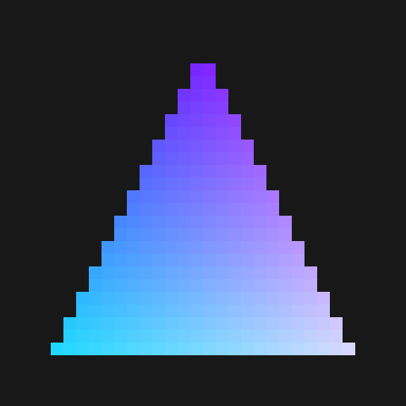

# M5 Linux compute triangle

On 2026-09-11, a fresh native Linux RAM boot on J813 executed a fixed compute
shader producing a 32x32 RGBA triangle. Mode11 retains the original mode10
arithmetic test and adds a separate shader, pipeline, and owned constant page.

This is compute-based rasterization. It does not qualify the vertex/fragment
graphics pipeline, general shader compilation, a Mesa render node, or DCP.

## Hardware result

- All 1,024 output pixels verified independently from retained GPU memory.
- 288 colored foreground pixels and 736 background pixels; no invalid pixels.
- All 1,024 input values unchanged; output sentinels replaced.
- Queue11, stamp1, context3; outer counters retired to `[2,2,2]`, inner to `[4,4,4]`.
- No reported GPU restart; initialization transaction and both stop requests succeeded.
- 34 retained objects, 247 physical pages, no read errors; all object hashes verified.
- Completion-ring interrupt delivery is not established by this test.

The displayed image enlarges each source pixel 16 times without filtering.
The raw RGBA SHA256 is `789e600fb641b0028a4f14244136371df5c2821bcdab5f11a4ec8a32464fb5b9`.



## Reproduce after a fresh diagnostic Linux RAM boot

Use the existing J813 boot tooling and preserve resident Stage1. Run once per
boot; the diagnostic deliberately retains its owners until reset.

```sh
M5_FW_TRACE=0x203 python3 gpu/run-m5-queue-install-probe.py 11
python3 gpu/capture-m5-linux-compute-state.py BOOT_INVENTORY CAPTURE --after-success --triangle
python3 gpu/verify-m5-compute-triangle.py CAPTURE OUTPUT_PREFIX
```

The verifier checks the capture hashes, exact shader/pipeline/constant pages,
unchanged inputs, and independent triangle edge equations before emitting any
image. It writes raw RGBA, a 32x32 PNG, a 512x512 enlargement, and a JSON result.
Neither the verifier nor the kernel's CPU initialization computes the GPU
output buffer: initialization fills it with `0xdeadbeef`.

## Program and capture provenance

The native compute reference is `sksm-submit-1789112652493773000` in
`m5-triangle-native-hv-20260911`. Its command stream and compute registers match
the working arithmetic profile except native dispatch identities and the
native pool selection. Linux keeps its own identities and populated pool0.

The triangle profile contains the first 1,216 shader bytes, 172 pipeline bytes,
and a 64-byte constant record. Each has a separate owned mapping; unused page
bytes are zero. Buffer bindings point to Linux-owned input/output memory.
The arithmetic shader, pipeline, and stream constants are unchanged.

Module SHA256: `9d724422041cf91d8a78dec0275302e428f4dca452d0601f06488909ca1ba1f5`.
Logs: `m5-compute-triangle-linux-boot-20260911.log`,
`m5-compute-triangle-linux-probe-20260911.log`, and
`m5-compute-triangle-linux-retained-20260911`.

Separately, the controlled native graphics workload produced a 256x256
triangle with 18,432 foreground pixels and 47,104 background pixels.
After excluding WindowServer queues2/3, native graphics captures matched the
test's context3: TA queue9 and fragment queue10, both stamp2. They contain 82
TA registers and 90 fragment registers. These are references for the next
Linux graphics work, not Linux TA/3D evidence.
